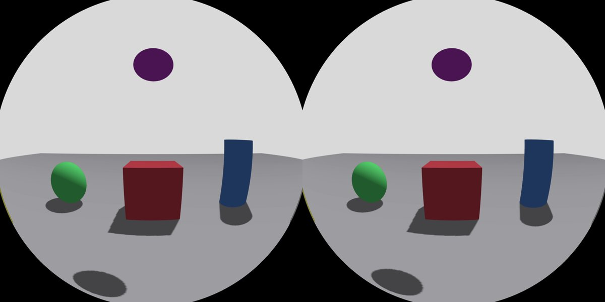
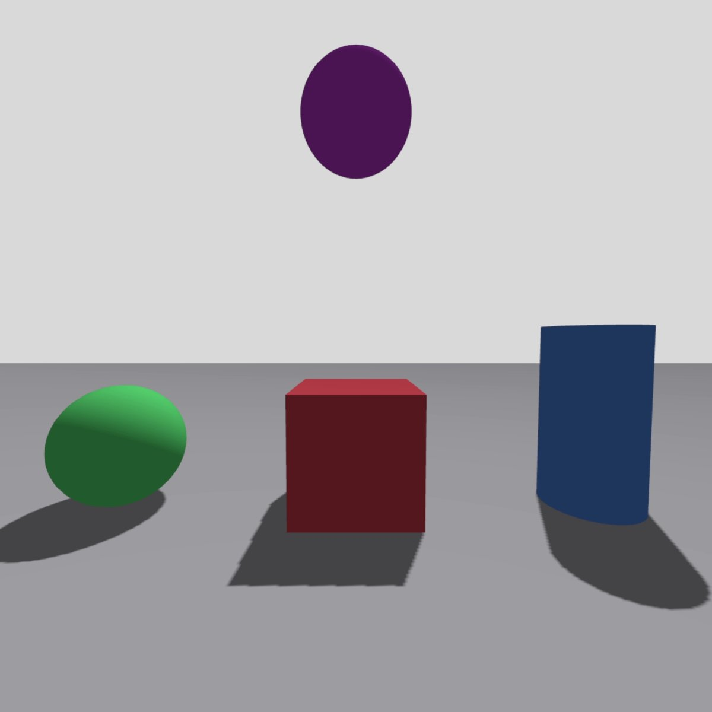

# sntv_gazebo

A [Gazebo Sim](https://gazebosim.org) system plugin that turns any link of your
model into a **GPU video source**: it renders a mono or stereo camera rig
(perspective or fisheye), composes it, encodes it with **NVENC** without the
image ever leaving the GPU, and serves it to one receiver over
[SNTV](https://github.com/alexoberco/sntv), with the world pose of each view
attached to every frame.

| Stereo, 150° sine fisheye, 2×1440 px, HEVC | Mono, 90° perspective, 1280 px, H.264 |
|---|---|
|  |  |

Made for teleoperating a simulated robot from a VR headset (the
[Sentinel](https://github.com/alexoberco) project), where the robot's eyes have
to reach the headset sharp, smooth and with low latency. Pair it with
[sntv_unity](https://github.com/alexoberco/sntv_unity) on a Meta Quest, or read
the stream from anything that speaks SNTV.

## Why not a Gazebo camera sensor + a ROS image topic?

A Gazebo camera sensor reads every image back from the GPU **synchronously**,
copies it several times and ships it raw over gz-transport, while physics
waits. Measured on an RTX 5060 Ti, a 150° wide-angle camera sensor managed
45 Hz at 1600 px, 37 Hz at 1920 and 25 Hz at 2160, with the GPU almost idle,
and it ignores anti-aliasing. Then something still has to encode it.

This plugin renders with MSAA, composes with 4 samples per pixel and hands the
texture straight to the hardware encoder. Measured with the examples here
(RTX 5060 Ti, Gazebo Harmonic, real-time factor 1.00 in both):

| Example | Output | Rate | Render thread per frame | NVENC |
|---|---|---|---|---|
| `stereo_fisheye.sdf` | 2880×1440 HEVC, 10 faces | 45.5 fps, 0 dropped | 13.4 ms | 3.6 ms |
| `mono_perspective.sdf` | 1280×1280 H.264, 1 face | 62.5 fps, 0 dropped | 1.4 ms | 1.0 ms |

The Sentinel plugin it was extracted from runs at 2880 px **per eye**
(5760×2880), 45–60 fps, alongside the full robot simulation.

## Requirements

- Linux with an **NVIDIA GPU** and its driver (NVENC, `libnvidia-encode.so.1`).
- **Gazebo Harmonic** (gz-sim 8, gz-rendering 8 with ogre2), standalone or
  through ROS 2 Jazzy's vendor packages.
- NVENC headers: `sudo apt install libffmpeg-nvenc-dev`.
- Gazebo started with **`--headless-rendering`** (EGL). The plugin shares
  Ogre's OpenGL context, and with GLX (the GUI) there is no EGL context to share;
  it then logs an error and stays off. Run the GUI as a separate client if you
  need one.

## Build

In a ROS 2 workspace:

```bash
cd ~/ros2_ws/src && git clone https://github.com/alexoberco/sntv_gazebo.git
cd ~/ros2_ws && colcon build --packages-select sntv_gazebo && source install/setup.bash
```

Sourcing the workspace adds the plugin to `GZ_SIM_SYSTEM_PLUGIN_PATH`.

Without ROS:

```bash
cmake -B build && cmake --build build && sudo cmake --install build
export GZ_SIM_SYSTEM_PLUGIN_PATH=/usr/local/lib:$GZ_SIM_SYSTEM_PLUGIN_PATH
```

## Try it

```bash
gz sim -s -r --headless-rendering examples/stereo_fisheye.sdf
python3 sntv/tools/sntv_receive.py --port 8766 --seconds 10 --save frame.png   # from the sntv repo
```

The plugin prints a line every 5 s on stderr:
`[sntv] 45.4 fps | render faces 13.4 ms, compose 0.09 | encoder: wait GPU 0.26 ms, NVENC 3.6 | ... dropped 0, skipped 0`.

## Use it in your model

Two pieces: a tiny **clock sensor**, which says where the rig is and how often
it renders, and the **plugin**. The world needs the Sensors system with
`ogre2`.

```xml
<link name="head">
  <!-- Rig centre = this sensor's pose; optical axis = its +X. Renders at update_rate. -->
  <sensor name="sntv_clock" type="camera">
    <always_on>true</always_on>
    <update_rate>45</update_rate>
    <topic>/sntv/clock</topic>
    <camera>
      <horizontal_fov>0.5</horizontal_fov>
      <image><width>16</width><height>16</height></image>
    </camera>
  </sensor>
</link>

<plugin filename="sntv_gazebo_system" name="sntv::StreamSystem">
  <layout>stereo</layout>
  <projection>sine</projection>
  <fov_deg>150</fov_deg>
  <view_size>1920</view_size>
  <fps>45</fps>
</plugin>
```

Why a clock sensor: Gazebo only runs its render thread when some sensor is due.
The plugin hooks into the end of every render (an `Ogre::FrameListener`), so the
16×16 sensor sets the frame rate without the cost of a real camera, and it gives
the rig a parent link that moves with your robot.

### Parameters

| Element | Default | Meaning |
|---|---|---|
| `port` | 8766 | TCP port to serve SNTV on |
| `bind_address` | 0.0.0.0 | Interface to listen on |
| `clock_sensor` | sntv_clock | Name (suffix) of the camera sensor that anchors the rig |
| `clock_topic` | /sntv/clock | That sensor's `<topic>`; the plugin subscribes so Gazebo keeps it alive |
| `layout` | stereo | `mono` or `stereo` (views side by side, left first) |
| `ipd` | 0.063 | Distance between the two views, m |
| `projection` | equidistant | `perspective`, `equidistant` or `sine` (see the SNTV spec) |
| `fov_deg` | 150 (90 for perspective) | Field of view across one view |
| `lens_c2` | 1.0 | Sine lens parameter: 1 gives the centre 1.355× the px/degree of an equidistant lens at 150° |
| `cutoff_deg` | 90 | Fisheye rays beyond this angle are black (max 90) |
| `view_size` | 1920 | Pixels per side of each (square) view |
| `fps` | 45 | Frame rate; match the clock sensor's `update_rate` |
| `codec` | hevc | `hevc` or `h264` (H.264 on NVENC tops out at 4096 px wide) |
| `bitrate` | 40000000 | CBR target, bit/s; the encoder's buffer holds one frame |
| `msaa` | 4 | Anti-aliasing samples of the face cameras |
| `face_scale` | 1.0 | Face resolution relative to the view's centre px/degree |
| `peripheral_scale` | 0.7 | Side faces relative to the front one (fisheyes need fewer px/degree there) |
| `near`, `far` | 0.02, 200 | Clip planes, m |
| `shadows` | true | `false` turns shadows off **in the whole scene**: Ogre renders the shadow maps again for every face camera (−5 ms of render thread with 10 faces) |
| `view_poses` | true | Attach each view's world pose to every frame (SNTV metadata type 1) |
| `frame_topic` | (none) | If set, publishes each frame's simulation time (`gz.msgs.Int64`) on this gz topic |

### How it works

A view needs up to five 90° cube faces (front, left, right, up, down). A narrow
lens (≤ ~120° perspective) uses just the front one, with its field of view set
to fit. Each frame, on Gazebo's render thread:

1. The face cameras render (MSAA), parented to the clock sensor's link.
2. A private OpenGL 4.5 context, shared with Ogre's, composes each view with a
   fragment shader (4 samples per pixel) into one of four textures in a ring.
3. An encoder thread with its own context waits on that frame's GPU fence and
   hands the texture to NVENC (OpenGL input: no CUDA, no CPU copy); a collector
   thread takes the bitstream out while the next frame is already encoding.
4. A network thread sends it, with its simulation timestamp and the pose of
   each view taken from the scene graph during that same render.

If the receiver falls behind by more than three frames, the backlog is dropped
and the next frame is an IDR. If the encoder falls behind by a whole ring, the
frame is skipped. Both are counted in the log line.

## License and credit

[Apache License 2.0](LICENSE). Use it, change it, sell products built on it. In
exchange, any redistribution must keep the copyright notices and ship the
[NOTICE](NOTICE) file, or its text in your credits or documentation.
`include/sntv/sntv.h` is a copy of the one in the
[sntv](https://github.com/alexoberco/sntv) repo.
